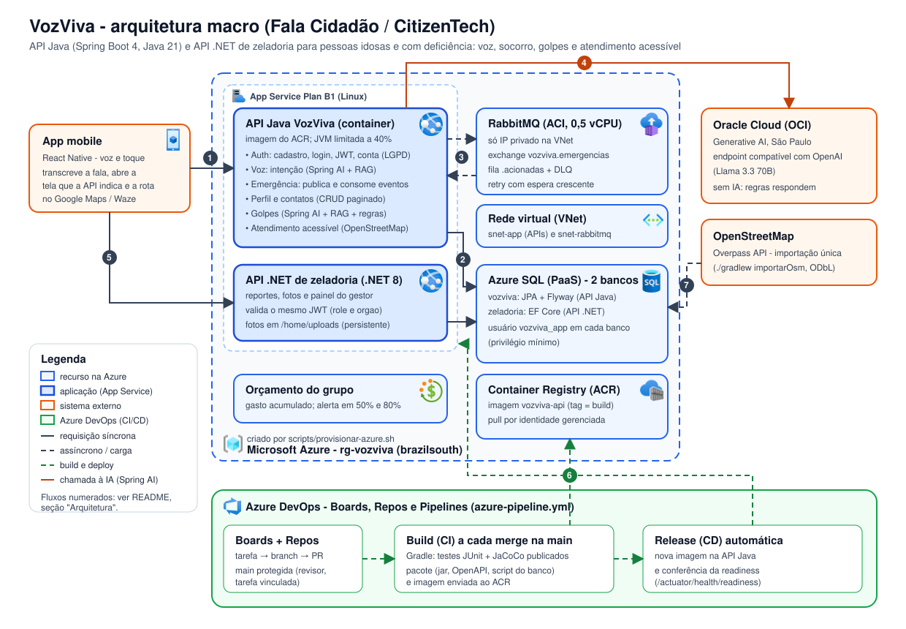

# VozViva

Motor de inteligência e interface de voz do ecossistema **Fala Cidadão** (CitizenTech – FIAP Global Solution).
Microsserviço Java que ajuda idosos e pessoas com deficiência no dia a dia, por toque ou por voz: pedido de socorro
com aviso à rede de apoio, assistente contra golpes e atendimento acessível mais próximo com rota no celular.

As especificações das funcionalidades estão em [`specs/specs.json`](specs/specs.json).

| | |
|---|---|
| **API publicada (Azure)** | _a preencher depois do deploy_: `https://<webAppName>.azurewebsites.net/swagger-ui.html` |
| **Swagger local** | http://localhost:8080/swagger-ui.html |
| **Vídeo pitch** | _a preencher_ |
| **Roteiro das apresentações** | [`docs/roteiro-apresentacao.md`](docs/roteiro-apresentacao.md) |
| **Requisito 5 (Java Advanced)** | **Opção A: RabbitMQ.** O botão de emergência publica o evento e um consumidor assíncrono avisa os contatos ([detalhes](#botão-de-emergência-arquitetura-distribuída--opção-a-rabbitmq)) |

## Integrantes

| Nome | RM | Turma |
|---|---|---|
| _a preencher_ | _a preencher_ | _a preencher_ |

## O problema e quem a solução atende

O Brasil tem **32,1 milhões de pessoas com 60 anos ou mais**, 56% a mais que em 2010, e **14,4 milhões de
pessoas com deficiência** (7,3% da população), segundo o Censo 2022 do IBGE. A cidade não acompanha essa
população:
- 68,8% dos moradores de áreas urbanas vivem em ruas sem nenhuma rampa para cadeirantes;
- só 18,8% moram em ruas com calçadas livres de obstáculos;
- a pobreza é maior entre as pessoas com deficiência.

O resultado é um "confinamento domiciliar involuntário": a pessoa deixa de ir ao posto de saúde e passa a
depender de terceiros. Ela também fica mais exposta a golpes digitais, porque usa o celular com pouco letramento
digital. Os dados vêm do relatório de dores do grupo, em [`Dores Dos Grupos CitizenTech.md`](Dores%20Dos%20Grupos%20CitizenTech.md).

**Quem a solução atende:** idosos e pessoas com deficiência (mobilidade reduzida, deficiência visual ou
auditiva) e os cuidadores deles, com o piloto em Osasco/SP.

## A solução

O VozViva é a API Java do ecossistema **Fala Cidadão**. A pessoa usa o app por **voz** ou com **um toque**, sem
menus complicados:

| Funcionalidade | Dor que resolve |
|---|---|
| **Classificação por voz** (Spring AI + RAG) | Quem não consegue digitar ou navegar em menus diz o que precisa e o app abre a tela certa |
| **Botão de emergência** (RabbitMQ) | Quedas e mal-estar em casa: os contatos são avisados em segundos, com localização e informações de saúde |
| **Perfil de emergência e contatos** | Quem mora sozinho (ou o cuidador) organiza a rede de apoio e as informações que vão na mensagem de socorro |
| **Assistente contra golpes** (Spring AI + RAG) | Golpes do falso INSS, falso parente e falsa central: "isso é golpe?", com orientação oficial e canal para confirmar |
| **Atendimento acessível mais próximo** | Hospital, UPA, UBS ou farmácia mais perto, de preferência com acessibilidade, e a rota aberta no Google Maps ou no Waze |

**Ecossistema:**
- **App mobile** (React Native): voz, toque e rota.
- **API Java**, este repositório: identidade e JWT, voz, socorro, golpes e atendimentos, com Azure SQL.
- **API .NET**: zeladoria e cadastros oficiais, com Oracle, validando o mesmo JWT.

**ODS atendidos:**

| ODS | Como |
|---|---|
| **3 – Saúde e bem-estar** | Socorro rápido com a rede de apoio, caminho até o atendimento de saúde e orientação de ligar 192 |
| **10 – Redução das desigualdades** | Acesso por voz para quem tem baixo letramento digital ou deficiência, e proteção contra golpes que atingem os mais vulneráveis |
| **11 – Cidades e comunidades sustentáveis** | Prioriza destinos acessíveis e encaminha problemas da calçada para a zeladoria |

## Impacto e modelo de negócio

### Como o impacto é medido

Os indicadores saem dos dados que a API já grava, sem guardar a localização das buscas nem o texto das mensagens
verificadas:

| Indicador | Origem | O que mostra |
|---|---|---|
| Tempo entre o toque e o aviso aos contatos | `emergencias` (`notificada_em` − `acionada_em`) | Se o socorro chega em segundos |
| Taxa de emergências em `FALHA_NO_AVISO` | `emergencias` | Contatos desatualizados ou falha de entrega, para agir antes que a pessoa precise |
| Emergências atendidas pelo cuidador × canceladas | `emergencias` (`ATENDIDA` e `CANCELADA`) | Se a rede de apoio responde |
| Golpes identificados por tipo | `GET /api/v1/verificacoes/estatisticas` (anônimo) | Golpes que circulam na cidade, para campanhas de prevenção |
| Falas entendidas × `PEDIR_REPETICAO` | `interacoes_voz` | Se o acesso por voz funciona para quem tem pouco letramento digital |
| Pessoas com perfil e rede de apoio | `perfis_emergencia` e `contatos_emergencia` | Alcance do piloto (cidadãos que se cadastraram sozinhos e com cuidador) |

**Metas do piloto em Osasco/SP** (propostas, a confirmar com a prefeitura): aviso aos contatos em menos de 30
segundos em 95% das emergências; menos de 2% das emergências em `FALHA_NO_AVISO`; pelo menos 80% das falas
entendidas sem pedir repetição.

### Como o impacto é ampliado

- **Outras cidades:** os locais de atendimento vêm do OpenStreetMap. Para uma nova cidade, troca-se a área
(`ImportadorOsm.AREA`) e roda-se `./gradlew importarOsm`, que gera a carga do banco; o resto da API não muda.
- **Novos golpes:** as orientações do assistente ficam numa base curada (RAG). Um golpe novo entra como documento,
sem treinar modelo.
- **Ecossistema:** a API .NET valida o mesmo JWT, então novos serviços (zeladoria, saúde, assistência social)
usam a mesma conta do cidadão.
- **Custo de IA controlado:** as regras respondem sem IA, então a solução continua funcionando com o orçamento
de IA zerado ou com o provedor fora do ar.

### Quem paga e como se sustenta

Para o cidadão e o cuidador o app é **gratuito**. A receita vem de quem economiza com ele, conforme o relatório de
dores do grupo:

| Modelo | Quem paga | Por que paga |
|---|---|---|
| **B2G** (assinatura) | Prefeituras e secretarias de saúde e assistência social | Menos internações por demora no socorro, menos filas no CRAS e dados para campanhas contra golpes |
| **B2B2C** | Planos de saúde e clínicas com clientes da terceira idade | Menos custo de central de atendimento e de internações evitáveis; o plano oferece o app aos clientes |
| **Dados anônimos** | Planejamento urbano, concessionárias de transporte e construtoras | Mapas de calor (sem dado pessoal, conforme a LGPD) de obstáculos nas calçadas e de destinos procurados por PcD |

**Quem participa:** cidadão e cuidador (usuários), contatos de emergência (rede de apoio), prefeitura (zeladoria e
saúde, pela API .NET), SAMU 192 (sempre indicado nas emergências) e OpenStreetMap (dados abertos, licença ODbL).

**Custo de operação:** o ambiente da Azure criado pelo script (App Service B1, Azure SQL Basic, ACR Basic e um
RabbitMQ em container) é de entrada e atende o piloto. Para crescer, sobe-se o plano do App Service e do banco, sem
mudar a arquitetura.

## Stack

- Java 21 · Spring Boot 4 · Gradle
- Spring Data JPA + Flyway – Azure SQL em produção, SQL Server no desenvolvimento, H2 nos testes
- Spring Security – JWT e controle de acesso por papel
- Spring AI – assistente contra golpes (RAG) e classificação de intenção por voz
- RabbitMQ – evento assíncrono do botão de emergência

## Arquitetura



Versão editável no draw.io: [`docs/arquitetura.drawio`](docs/arquitetura.drawio). Abra em https://app.diagrams.net
(Arquivo → Abrir de → Dispositivo) ou arraste o arquivo para a página.

| # | Fluxo |
|---|---|
| 1 | O app (React Native) transcreve a fala ou recebe o toque e chama a API Java por HTTPS, com o JWT no header `Authorization` |
| 2 | A API lê e grava no Azure SQL com Spring Data JPA; o esquema é versionado com Flyway |
| 3 | O botão de emergência grava o pedido, publica o evento no RabbitMQ e responde 202; o consumidor avisa os contatos em segundo plano, com retry e DLQ |
| 4 | O assistente contra golpes e a classificação por voz chamam o modelo na OCI pelo Spring AI, com RAG; sem IA, as regras respondem |
| 5 | O app também usa a API .NET (zeladoria, Oracle), que valida o mesmo JWT emitido pela API Java |
| 6 | Azure DevOps: tarefa no Boards, branch e PR no Repos; o merge na main dispara o build com testes, a imagem vai para o ACR e a release a publica no App Service |
| 7 | Os locais de atendimento vêm de uma importação única do OpenStreetMap, aplicada pelo Flyway como carga do banco |

## Pré-requisitos

- JDK 21
- Docker (Docker Desktop no Windows)
- [Gitleaks](https://github.com/gitleaks/gitleaks) – `winget install Gitleaks.Gitleaks`

## Executando localmente

```bash
# 1. Variáveis de ambiente (o perfil dev lê o .env automaticamente)
cp .env.example .env        # preencha DB_PASSWORD, RABBITMQ_PASSWORD, JWT_SECRET, USUARIOS_TESTE_SENHA e OCI_GENAI_API_KEY

# 2. Infraestrutura (SQL Server + RabbitMQ); o banco "vozviva" é criado na primeira subida
docker compose up -d --wait

# 3. Aplicação (perfil dev por padrão)
./gradlew bootRun
```

- API: http://localhost:8080
- Health check: http://localhost:8080/actuator/health
- Painel do RabbitMQ: http://localhost:15672 (usuário `vozviva` e a senha definida em `RABBITMQ_PASSWORD`)

Para parar a infraestrutura: `docker compose down` (adicione `-v` para apagar os dados).

## Perfis

| Perfil | Uso | Conexões |
|---|---|---|
| `dev` (padrão) | Desenvolvimento local | Host, porta e usuário padrão compatíveis com o `docker-compose.yml`; senha vem do `.env` |
| `test` | Testes automatizados | H2 em memória (modo SQL Server); Testcontainers nos testes de integração; nenhum serviço externo necessário |
| `prod` | Produção | Sem valores padrão: falha ao iniciar se faltar `DB_URL`, as credenciais do banco ou do RabbitMQ |

Selecione com `SPRING_PROFILES_ACTIVE=prod`.

## Documentação da API (Swagger)

Com a aplicação no ar:

- **Swagger UI:** http://localhost:8080/swagger-ui.html
- **Contrato OpenAPI (JSON):** http://localhost:8080/v3/api-docs. O build também salva uma cópia em
  `build/openapi/openapi.json`, para o time mobile e o time .NET.

Para testar pelo Swagger:
1. Chame `POST /api/v1/auth/login`. No perfil dev existem `cidadao.teste@vozviva.dev`,
   `cuidador.teste@vozviva.dev` e os gestores da tabela de usuários de teste, com a senha de `USUARIOS_TESTE_SENHA`.
2. Copie o `accessToken` da resposta e clique em **Authorize**.
3. Experimente os endpoints. O token fica guardado entre recarregamentos da página.

Os endpoints estão agrupados por módulo: Autenticação, Voz, Botão de emergência, Perfil de emergência, Contatos
de emergência, Assistente contra golpes e Atendimento acessível. Cada operação tem descrição e exemplos de
requisição. As respostas de erro documentadas são as que a operação pode devolver (400, 401, 403, 404, 409,
429, 500), com o formato `ErroResponse` e um exemplo com `mensagemFalada`. O teste `OpenApiDocumentacaoTest`
quebra o build se um endpoint ficar fora do contrato ou sem descrição.

### Endpoints principais

| Módulo | Endpoints |
|---|---|
| Autenticação | `POST /api/v1/auth/cadastro` · `POST /api/v1/auth/login` · `GET /api/v1/auth/eu` · `DELETE /api/v1/auth/eu` |
| Voz | `POST /api/v1/voz/intencoes` · `GET /api/v1/voz/interacoes` |
| Botão de emergência | `POST /api/v1/emergencias` · `GET /api/v1/emergencias` · `GET /api/v1/emergencias/{id}` · `GET /api/v1/emergencias/{id}/avisos` · `PATCH /api/v1/emergencias/{id}/cancelar` · `PATCH /api/v1/emergencias/{id}/atender` |
| Perfil de emergência (CRUD) | `POST`, `GET` (paginado), `GET /meu`, `GET /{id}`, `PUT /{id}`, `DELETE /{id}` em `/api/v1/perfis-emergencia` |
| Contatos de emergência (CRUD) | `POST`, `GET` (paginado), `GET /{contatoId}`, `PUT /{contatoId}`, `DELETE /{contatoId}` em `/api/v1/perfis-emergencia/{perfilId}/contatos` |
| Assistente contra golpes | `POST /api/v1/verificacoes` · `GET /api/v1/verificacoes/estatisticas` |
| Atendimento acessível | `GET /api/v1/atendimentos/proximos` · `GET /api/v1/atendimentos` · `GET /api/v1/atendimentos/{id}` |

## Variáveis de ambiente

| Variável | Descrição |
|---|---|
| `OCI_GENAI_API_KEY` | API key do OCI Generative AI (sem ela, o assistente usa só as regras) |
| `OCI_GENAI_BASE_URL` | Endpoint compatível com OpenAI da OCI (padrão `https://inference.generativeai.sa-saopaulo-1.oci.oraclecloud.com/openai/v1`) |
| `OCI_GENAI_MODEL` | Modelo usado (padrão `openai.gpt-oss-120b`) |
| `VOZ_CONFIANCA_MINIMA` | Confiança mínima para a IA decidir a intenção sozinha (padrão `0.6`) |
| `DB_URL` | URL JDBC do banco (Azure SQL em produção; padrão do dev aponta para o SQL Server do docker-compose) |
| `DB_USERNAME` / `DB_PASSWORD` | Credenciais do banco (no dev, usuário `sa` e a senha do `.env`) |
| `RABBITMQ_HOST` / `RABBITMQ_PORT` | Endereço do RabbitMQ |
| `RABBITMQ_USERNAME` / `RABBITMQ_PASSWORD` | Credenciais do RabbitMQ |
| `JWT_SECRET` | Segredo de assinatura do JWT, compartilhado com a API .NET (mínimo de 32 caracteres). Obrigatório, exceto se `JWT_JWKS_URI` for usado |
| `JWT_ISSUER` | Emissor do token (claim `iss`): `voz-e-via-java`, o mesmo que a API .NET espera |
| `JWT_AUDIENCE` | Audiência do token (claim `aud`): `voz-e-via`, a mesma que a API .NET espera |
| `JWT_ALGORITMO` | `HS256` (padrão), `HS384` ou `HS512` |
| `JWT_EXPIRACAO` | Validade do token emitido no login (padrão `2h`) |
| `USUARIOS_TESTE_HABILITADO` | Cria os usuários de teste ao iniciar (padrão `true` no dev e `false` no prod) |
| `USUARIOS_TESTE_SENHA` | Senha dos usuários de teste; sem ela, nada é criado |

## Padrão DTO

Os controllers nunca expõem entidades, `Map` ou `Object`: tudo que entra e sai da API é um **DTO**.

| Regra | Exemplo |
|---|---|
| DTOs ficam no pacote `dto` | `dto.ContatoEmergenciaRequest` |
| DTOs são `record` (imutáveis) | `public record ContatoEmergenciaResponse(Long id, String nome) {}` |
| Entrada termina em `Request`, saída em `Response` | `ContatoEmergenciaRequest`, `ContatoEmergenciaResponse` |
| Endpoints recebem DTO no `@RequestBody` e devolvem DTO (ou `ResponseEntity`/`List` de DTO) | `ResponseEntity<ContatoEmergenciaResponse> criar(@RequestBody @Valid ContatoEmergenciaRequest r)` |
| Controllers não acessam entidades (`@Entity`) nem repositórios: passam por um serviço | `controller → service → repository` |
| DTOs não dependem de entidades; a conversão fica no pacote `mapper` | `PerfilEmergenciaMapper.paraResponse(contato)` |
| Validação (`@NotBlank`, `@Valid`...) fica no DTO de entrada | `record ContatoEmergenciaRequest(@NotBlank String nome, ...)` |

Essas regras são verificadas por testes de arquitetura com ArchUnit (`ArquiteturaDtoTest`): uma
violação quebra o build. O contrato de erro também é um DTO: `dto.ErroResponse`.

## Segurança

A API Java é a dona da identidade do ecossistema: cadastra os usuários e emite o JWT. Ela valida o token
em todas as chamadas (Resource Server) e aplica controle de acesso por papel. A API .NET valida o mesmo
token, com o mesmo segredo e emissor.

| Endpoint | Acesso | O que faz |
|---|---|---|
| `POST /api/v1/auth/cadastro` | Público | Cria a conta (`nome`, `email`, `senha`, `papel`: `CIDADAO` ou `CUIDADOR`, `consentimento`: `true`) |
| `POST /api/v1/auth/login` | Público | Devolve `accessToken`, `tokenType`, `expiraEm` e os dados do usuário |
| `GET /api/v1/auth/eu` | Token | Dados do usuário autenticado (com `consentimentoEm`) |
| `DELETE /api/v1/auth/eu` | Token | Exclui a própria conta (LGPD): 204, ou 401 sem token válido |

Use o token em todas as outras chamadas:

```
Authorization: Bearer <accessToken>
```

**Usuários de teste** (criados no perfil dev, ou em produção com `USUARIOS_TESTE_HABILITADO=true`), com a
senha definida em `USUARIOS_TESTE_SENHA`:

| E-mail | Papel |
|---|---|
| `cidadao.teste@vozviva.dev` | `CIDADAO` |
| `cuidador.teste@vozviva.dev` | `CUIDADOR` |
| `gestor.obras@vozviva.dev` | `GESTOR` (Secretaria de Obras), para a API .NET |
| `gestor.iluminacao@vozviva.dev` | `GESTOR` (Iluminação Pública), para a API .NET |

Proteções do login: senha com BCrypt (mínimo de 8 caracteres, com letra e número); a mesma resposta para
e-mail inexistente e senha errada, inclusive no tempo de resposta; bloqueio de 15 minutos (HTTP 429) depois
de 5 erros seguidos no mesmo e-mail.

### Contrato do token (para a API .NET validar)

| Item | Valor |
|---|---|
| Algoritmo | HS256, com o mesmo `JWT_SECRET` (mínimo de 32 caracteres) |
| `iss` | Valor de `JWT_ISSUER` (`voz-e-via-java`) |
| `aud` | Valor de `JWT_AUDIENCE` (`voz-e-via`) |
| `sub` | Id do usuário |
| `role` | `CIDADAO`, `CUIDADOR` ou `GESTOR` |
| `orgao` | Só no token do gestor: `OBRAS`, `ILUMINACAO`, `MOBILIDADE` ou `LIMPEZA` (a API .NET monta a fila do gestor com ele) |
| `name` | Nome do usuário |
| `iat` / `exp` | Emissão e expiração (validade de `JWT_EXPIRACAO`) |

Na validação, o token precisa ter assinatura válida, `exp` (tokens sem expiração são recusados), o `iss`
configurado e um papel conhecido; valores desconhecidos nunca dão acesso.

### Matriz de acesso

| Rota | Acesso |
|---|---|
| `GET /actuator/health`, `GET /actuator/info` | Público |
| `POST /api/v1/auth/cadastro`, `POST /api/v1/auth/login` | Público |
| `GET /v3/api-docs/**`, `GET /swagger-ui/**` | Público |
| Consumo de dados de suporte (atendimentos próximos, verificação de golpes, classificação por voz...) | `CIDADAO` ou `CUIDADOR` |
| Perfil de emergência e contatos (criar e alterar) | O próprio cidadão ou o cuidador responsável |
| `GET /api/v1/auth/eu`, `DELETE /api/v1/auth/eu` | Qualquer papel, inclusive `GESTOR` |
| Qualquer outra rota | Token válido |

O `GESTOR` é o servidor da prefeitura que atende a zeladoria na API .NET. Aqui ele só faz login e cuida da
própria conta: todas as rotas de dados de cidadão respondem 403 para ele. Não existe cadastro público de gestor
(`papel: GESTOR` no cadastro responde 400); as contas são criadas pelo sistema, e o banco exige o órgão de todo
gestor (e só dele).

As regras por papel ficam nos endpoints com `@PreAuthorize`. Respostas 401 e 403 seguem o formato de
erro padrão da API, com `mensagemFalada` e `traceId`.

### CSRF

A proteção CSRF continua **ativa**, mas requisições com header `Authorization` não precisam do token CSRF:
um site malicioso não consegue fazer o navegador enviar esse header, e por isso o ataque não se aplica.
Assim, o app envia apenas o JWT, sem requisição extra para buscar um token CSRF. Requisições sem
`Authorization` continuam passando pelo CSRF (token em cookie `HttpOnly`, `Secure`, `SameSite=Strict`),
o que já protege um eventual login por cookie no futuro. Uma escrita sem JWT recebe 401
(`NAO_AUTENTICADO`), para o app saber que precisa entrar de novo.

## Perfil de emergência e contatos

O perfil de emergência guarda a mobilidade, as condições de saúde, os medicamentos e os contatos avisados
quando o cidadão aciona o socorro. Quem mora sozinho cria e mantém o próprio perfil. Um cuidador também pode
criar o perfil de um cidadão e mantê-lo. O perfil pode não ter cuidador.

| Endpoint | Acesso | O que faz |
|---|---|---|
| `POST /api/v1/perfis-emergencia` | `CIDADAO` ou `CUIDADOR` | O cidadão cria o próprio perfil (sem `cidadaoEmail`); o cuidador informa o e-mail da conta do cidadão |
| `GET /api/v1/perfis-emergencia` | `CUIDADOR` | Lista paginada dos perfis que ele gerencia |
| `GET /api/v1/perfis-emergencia/meu` | `CIDADAO` | O perfil do próprio cidadão |
| `GET /api/v1/perfis-emergencia/{id}` | Cuidador responsável ou o cidadão | Detalhe do perfil |
| `PUT` / `DELETE /api/v1/perfis-emergencia/{id}` | O cidadão dono ou o cuidador responsável | Atualiza / exclui |
| `POST /api/v1/perfis-emergencia/{id}/contatos` | O cidadão dono ou o cuidador responsável | Adiciona contato (até 10) |
| `GET /api/v1/perfis-emergencia/{id}/contatos` | Cuidador responsável ou o cidadão | Lista paginada dos contatos |
| `GET` / `PUT` / `DELETE /api/v1/perfis-emergencia/{id}/contatos/{contatoId}` | O cidadão dono ou o cuidador responsável | Detalhe / atualiza / exclui |

**Paginação:** `?page=0&size=10&sort=nome,asc` (a primeira página é a 0; no máximo 50 itens). A ordenação só
aceita campos públicos (perfis: `id`, `mobilidade`, `criadoEm`, `atualizadoEm`; contatos: `id`, `nome`,
`prioridade`, `parentesco`). Telefones aceitam os formatos brasileiros comuns e são devolvidos no padrão
`+55DDDNUMERO`, pronto para o app ligar.

**LGPD:**
- A mobilidade é dado de saúde e é opcional: sem ela, o perfil fica `NAO_INFORMADO` e a mensagem de socorro só
  não cita a mobilidade.
- O cadastro exige `consentimento: true` e grava a data do aceite (`consentimentoEm`).
- `DELETE /api/v1/auth/eu` exclui a conta e o que depende dela:
  - do cidadão, apaga o perfil, os contatos, as emergências, os avisos e o histórico de voz;
  - do cuidador, os perfis que ele cuidava continuam com os cidadãos, só sem o vínculo;
  - as estatísticas de golpe já são anônimas e não guardam o usuário;
  - o token da conta excluída para de valer na hora em toda a API Java. Fica guardado só o id numérico da
    conta, sem dados pessoais, em `contas_excluidas`. A API .NET só confere a assinatura, então aceita o token
    até ele expirar (no máximo `JWT_EXPIRACAO`, 2 h).

**Limitação conhecida:** o cuidador vincula o perfil pelo e-mail da conta do cidadão, sem confirmação do
cidadão. Num sistema em produção, o vínculo seria confirmado por convite.
## Botão de emergência (arquitetura distribuída — opção A: RabbitMQ)

```
App ──POST /api/v1/emergencias──▶ grava Emergencia (ACIONADA) ──após o commit──▶ publica EmergenciaAcionadaEvento
    ◀── 202 Accepted na hora                                                          │
                                                                                      ▼
               exchange vozviva.emergencias ──(emergencia.acionada)──▶ fila vozviva.emergencias.acionadas
                                                                                      │
          ConsumidorEmergencia: avisa os contatos por prioridade, grava cada aviso, status NOTIFICADA
                     3 tentativas com espera crescente ──falhou──▶ DLQ vozviva.emergencias.dlq
```

| Endpoint | Acesso | O que faz |
|---|---|---|
| `POST /api/v1/emergencias` | `CIDADAO` | Aciona a emergência (`latitude`, `longitude` e `textoOriginal` opcionais) → **202** |
| `GET /api/v1/emergencias` | `CIDADAO` / `CUIDADOR` | Histórico paginado (do cidadão ou dos perfis do cuidador) |
| `GET /api/v1/emergencias/{id}` | Cidadão dono ou cuidador responsável | Status atual |
| `GET /api/v1/emergencias/{id}/avisos` | Cidadão dono ou cuidador responsável | Quem foi avisado e com qual mensagem |
| `PATCH /api/v1/emergencias/{id}/cancelar` | `CIDADAO` dono | Cancela um acionamento por engano |
| `PATCH /api/v1/emergencias/{id}/atender` | `CUIDADOR` responsável | Encerra como atendida |

Garantias:
- **Publicação só depois do commit:** o consumidor nunca procura uma emergência que ainda não foi gravada.
- **Broker fora do ar não vira erro para o cidadão:** a emergência fica `ACIONADA` e o `ReenvioEmergencias`
  publica de novo a cada 30 s.
- **Consumo idempotente com trava da linha:** mensagens repetidas (reenvio ou nova entrega do broker) nunca
  avisam os contatos em dobro.
- **Toque duplo:** um novo acionamento em até 2 minutos devolve a emergência que já está aberta.
- **DLQ:** depois de 3 tentativas, a mensagem vai para `vozviva.emergencias.dlq` para análise.
- O envio real (SMS/WhatsApp) fica atrás da interface `NotificadorContatos`; a implementação padrão registra o
  aviso no log com o telefone mascarado.

O painel do RabbitMQ (http://localhost:15672) mostra as filas e as mensagens em JSON.
## Assistente contra golpes (Spring AI + RAG)

O cidadão cola ou dita uma mensagem suspeita e recebe, em linguagem simples, se parece golpe e o que fazer.

```
mensagem ──▶ 1. Regras determinísticas (senha, Pix com pressa, link, "troquei de número"...)  ─┐
         ──▶ 2. Recuperação (RAG): orientações oficiais mais parecidas, por TF-IDF              │
         ──▶ 3. IA generativa (Spring AI): analisa a mensagem com as orientações e devolve       │
                JSON estruturado (classificação, tipo, sinais, orientação, canal, frase falada)  │
                                                                                                ▼
                                 resposta = maior risco entre IA e regras  +  fontes oficiais usadas
```

| Endpoint | Acesso | O que faz |
|---|---|---|
| `POST /api/v1/verificacoes` | `CIDADAO` / `CUIDADOR` | Analisa `{ "texto": "...", "canal": "WHATSAPP" }` |
| `GET /api/v1/verificacoes/estatisticas?dias=30` | `CIDADAO` / `CUIDADOR` | Golpes mais frequentes no período (anonimizado) |

- **Base de conhecimento:** `src/main/resources/conhecimento/golpes.json`, com 14 orientações curadas, cada
  uma com o órgão de origem (INSS, Febraban, Banco Central, Procon-SP, Polícia Civil-SP, Ministério da Saúde,
  Receita Federal, Correios, MDHC) e o canal oficial para confirmar.
- **Por que TF-IDF e não busca vetorial:** a base é pequena e curada, a busca fica determinística e testável e
  não depende de um modelo de embeddings (o endpoint compatível com OpenAI da OCI não expõe embeddings). A evolução natural é a busca vetorial
  (embeddings da OCI ou Oracle 23ai Vector Search).
- **Segurança da IA:** a mensagem recebida vai delimitada e é tratada pelo modelo como dado, não como
  instrução (proteção contra *prompt injection*); as regras garantem que um pedido de senha nunca sai como
  "sem risco", mesmo que o modelo erre; sem IA (fora do ar, sem chave ou timeout de 30 s), as regras
  respondem sozinhas.
- **LGPD:** o texto da mensagem e o usuário nunca são gravados; só tipo, classificação, canal e data.
- **Modelo:** OCI Generative AI pelo endpoint compatível com a API da OpenAI (Spring AI + SDK oficial da
  OpenAI), configurável por `OCI_GENAI_MODEL` (padrão `openai.gpt-oss-120b`). O código depende só do
  `ChatModel` do Spring AI, então trocar de modelo ou provedor é só configuração.

### Avaliação

Conjunto versionado de 30 mensagens rotuladas (18 golpes, 12 legítimas) em
`src/test/resources/avaliacao/mensagens-rotuladas.json`, com golpes sem palavras óbvias e mensagens legítimas
de banco e saúde. "Golpe detectado" = `PROVAVEL_GOLPE` ou `SUSPEITA`.

| Configuração | Acurácia | Recall | Precisão | Falsos alarmes | Como rodar |
|---|---|---|---|---|---|
| Só regras (linha de base) | 83,3% | 72,2% | 100% | 0 | `./gradlew test` (relatório em `build/reports/avaliacao-golpes/somente-regras.md`) |
| IA + regras | meta ≥ 80% | meta ≥ 90% | — | — | `./gradlew avaliarIa` (exige `OCI_GENAI_API_KEY`; consome créditos da OCI) |

Os golpes que as regras não pegam são os semânticos (falso advogado, motoboy, "vaga de emprego"), que é
onde a IA agrega. As regras foram ajustadas com padrões gerais conhecidos ("somente hoje", "perdi meu
celular", "dados bancários"), não com as frases do conjunto; por ser pequeno, ele indica tendência, não
garante desempenho.

**Limitações:** o modelo pode errar golpes novos ou muito bem escritos (por isso a resposta nunca afirma
certeza e sempre indica o canal oficial); a base cobre os golpes mais comuns, não todos; a classificação não
substitui a confirmação no canal oficial.
## Classificação de intenção por voz (Spring AI + RAG)

O app transcreve a fala do cidadão e envia o texto. A API devolve qual tela abrir, com os dados já extraídos.
Ela só classifica e orienta: não executa nenhuma ação, e o socorro, por exemplo, é confirmado pela pessoa na tela.

| Rota | Papel | O que faz |
|---|---|---|
| `POST /api/v1/voz/intencoes` | `CIDADAO` / `CUIDADOR` | `{ "texto": "...", "localizacao": { "latitude": -23.53, "longitude": -46.78 } }` (localização opcional) |
| `GET /api/v1/voz/interacoes?page=0&size=10` | `CIDADAO` / `CUIDADOR` | Histórico do próprio usuário, das mais recentes para as mais antigas |

| Intenção | Ação do app | Exemplo de fala |
|---|---|---|
| `SOCORRO` | `ACIONAR_SOCORRO` | "Caí e não consigo levantar" |
| `BUSCAR_ATENDIMENTO` | `MOSTRAR_ATENDIMENTOS` | "Onde tem farmácia aqui perto?" |
| `VERIFICAR_INFORMACAO` | `MOSTRAR_VERIFICACAO` | "Recebi uma mensagem do INSS, é golpe?" |
| `ZELADORIA_REPORT` | `ABRIR_ZELADORIA_DOTNET` | "Tem um buraco na calçada e não passo com a cadeira" |
| `DESCONHECIDA` | `PEDIR_REPETICAO` | "Bom dia" |

A resposta traz `intencao`, `acao`, `urgencia` (`BAIXA` a `CRITICA`), `entidades` (`tipoAtendimento`,
`exigeAcessibilidade`, `problemaRua`, `impedeCadeirante`, `referenciaLocal`), `mensagemFalada` (até 200
caracteres), `confianca` e `analisadoPor`. Em `BUSCAR_ATENDIMENTO` com localização, ela já traz os
atendimentos mais próximos (o mesmo resultado de `GET /api/v1/atendimentos/proximos`): um toque a menos.

- **Saída estruturada:** o Spring AI mapeia a resposta do modelo direto para um record (`entity()`). A ação
  não vem do modelo: ela é decidida no servidor a partir da intenção, então a IA nunca dispara uma ação
  incoerente.
- **RAG:** os exemplos curados mais parecidos com a fala (`conhecimento/exemplos-intencoes.json`, 29 falas,
  recuperadas com o mesmo TF-IDF do assistente contra golpes) vão no prompt.
- **Segurança:**
  - Um pedido de socorro reconhecido pelas regras ou pelo modelo sempre vira `SOCORRO`, mesmo com pouca
    confiança. Na dúvida o app oferece ajuda, e a pessoa confirma na tela.
  - A fala vai delimitada e é tratada pelo modelo como dado (proteção contra *prompt injection*).
- **Confiança:** abaixo de `VOZ_CONFIANCA_MINIMA` (padrão 0,6), a IA não decide sozinha: valem as regras ou o
  app pede para repetir ("Você quer pedir ajuda, achar um atendimento perto, conferir uma mensagem ou avisar
  de um problema na rua?").
- **Sem IA:** as regras determinísticas respondem, sempre no mesmo contrato JSON. Isso vale com o modelo fora
  do ar, sem chave ou com resposta malformada.
- **LGPD:** o histórico guarda o texto, a intenção, a confiança e a latência, para o próprio usuário consultar
  e para avaliar a IA. A localização nunca é gravada.

### Avaliação

Conjunto versionado de 32 falas rotuladas (`src/test/resources/avaliacao/frases-intencoes.json`), diferentes
dos exemplos do RAG. Inclui transcrições sem acento e armadilhas, como "pronto socorro" (um lugar, não um pedido
de socorro) e "a árvore caiu" (zeladoria, não queda de uma pessoa).

| Configuração | Acurácia | Socorros reconhecidos | Socorros falsos | Como rodar |
|---|---|---|---|---|
| Só regras (linha de base) | 96,9% | 100% | 0 | `./gradlew test` (relatório em `build/reports/avaliacao-intencoes/`) |
| IA + regras | meta ≥ 90% | meta 100% | — | `./gradlew avaliarIa` (exige `OCI_GENAI_API_KEY`; consome créditos da OCI) |

Duas falhas das regras foram corrigidas depois da primeira medição: "alagou" não casava com "alaga", e
"calçada está toda quebrada" tinha palavras no meio. As duas correções são de padrão, e não de frase do
conjunto; mesmo assim, a linha de base fica otimista. A falha que sobrou ("meu remédio acabou, onde eu compro")
é semântica, que é onde a IA agrega. Com 32 falas, o resultado indica tendência, não garante desempenho.

## Atendimento acessível mais próximo ("Ir até lá")

Com um toque ("Hospital mais perto") ou por voz, o idoso ou a PcD encontra o atendimento do tipo desejado mais
perto de onde está, de preferência acessível, e abre a rota no Google Maps, no Waze ou em qualquer app que
entenda `geo:`. Não usa API paga de mapas: os links de rota não exigem chave.

| Rota | Papel | O que faz |
|---|---|---|
| `GET /api/v1/atendimentos/proximos?tipo=HOSPITAL&latitude=-23.53&longitude=-46.78&acessivel=true` | `CIDADAO` / `CUIDADOR` | Mais próximos no raio (`raioMetros`, padrão 5 km, até 20 km), até `limite` itens (padrão 3, máximo 10) |
| `GET /api/v1/atendimentos?tipo=UBS&page=0&size=10&sort=nome` | `CIDADAO` / `CUIDADOR` | Lista paginada (ordenação por `nome` ou `tipo`) |
| `GET /api/v1/atendimentos/{id}` | `CIDADAO` / `CUIDADOR` | Detalhe do local |

Tipos: `HOSPITAL`, `UPA`, `UBS`, `FARMACIA`, `CRAS`, `DELEGACIA`, `DEFENSORIA`.

- **Busca:** pré-filtro por área no banco (índice em tipo + latitude + longitude) e distância exata por
  Haversine, do mais próximo para o mais distante. A base inteira tem poucas centenas de linhas, então a
  resposta fica bem abaixo de 1 s.
- **Acessibilidade primeiro:** com `acessivel=true`, só entram locais com acessibilidade `SIM` ou `PARCIAL`,
  mesmo que estejam mais longe. Se não houver nenhum no raio, a resposta traz os de acessibilidade
  `DESCONHECIDA` com `semAcessivelNoRaio=true`, um aviso em cada item e a orientação de ligar antes. Um local
  sem informação nunca é apresentado como acessível.
- **Cada item** traz distância, acessibilidade, telefone, banheiro adaptado, 24 h e os links prontos
  (`rotas.googleMaps`, `rotas.waze`, `rotas.geo`), além de uma `mensagemFalada` curta
  ("O hospital mais perto com acessibilidade fica a 1,2 km. Se for urgência, ligue 192. Quer que eu abra o caminho?").
- **Urgência:** buscas por `HOSPITAL` e `UPA` sempre trazem `telefoneEmergencia: "192"` e a orientação de
  ligar para o SAMU em vez de ir sozinho.
- **LGPD:** a localização do usuário só é usada no cálculo e nunca é gravada.

### Dados (OpenStreetMap)

Os locais vêm de uma importação única de dados abertos do **OpenStreetMap** para Osasco/SP e arredores
(bairros vizinhos de São Paulo, Carapicuíba e Barueri):

```bash
./scripts/importar-osm.sh                                 # consulta a Overpass API (com espelhos de reserva)
./scripts/importar-osm.sh -Pentrada=resposta-overpass.json  # a partir de uma resposta salva
```

O importador (pacote `importer`) classifica cada elemento pelo nome e pelas tags (ex.: "UPA" ou
"Pronto Atendimento" vira `UPA`; "UBS" ou "Unidade Básica" vira `UBS`; só delegacias e distritos policiais
entram como `DELEGACIA`), converte a tag `wheelchair` (`yes`/`limited`/`no`) em `SIM`/`PARCIAL`/`NAO`, junta
o mesmo local mapeado duas vezes e gera `R__carga_pontos_atendimento.sql`, uma migração repetível do Flyway
(reaplicada quando o conteúdo muda).

Carga atual (base OSM de 28/07/2026): 237 locais, sendo 130 farmácias, 40 hospitais, 38 UBS, 25 delegacias
e 4 UPAs. Só 28 têm a acessibilidade informada no OSM; os demais aparecem como "acessibilidade não
informada".

**Dados © colaboradores do OpenStreetMap**, sob a licença [ODbL](https://www.openstreetmap.org/copyright).
O crédito também vai em toda resposta da busca (`creditoDados`), para o app exibir.

**Limitações:**
- O destino é filtrado pela acessibilidade, mas a rota calculada pelo app de navegação pode passar por
  calçadas ou travessias sem acessibilidade. A resposta avisa isso em `observacao`.
- A qualidade depende do mapeamento colaborativo: muitos locais não têm acessibilidade nem telefone
  informados.
- CRAS e Defensoria Pública ainda não estão mapeados no OSM na região. Os tipos existem e passam a aparecer
  quando forem mapeados e a carga for refeita.

## Banco de dados

O esquema é versionado com **Flyway** em `src/main/resources/db/migration` (`V1__descricao.sql`, `V2__...`).
A carga dos locais de atendimento é a migração repetível `R__carga_pontos_atendimento.sql`.
O Hibernate apenas valida as entidades (`ddl-auto=validate`); nunca cria tabelas sozinho.

`scripts/script-bd.sql` reúne todas as migrações (DDL e carga) num único script (exigência da disciplina de DevOps). Depois de
criar ou alterar uma migração, rode `./gradlew gerarScriptBd`: o `check` (e o CI) falha se o arquivo estiver
desatualizado.

## Deploy na Azure (DevOps)

| Artefato | Onde |
|---|---|
| Dockerfile (multi-stage, JRE 21, usuário sem privilégios, healthcheck) | [`dockerfiles/Dockerfile`](dockerfiles/Dockerfile) |
| Provisionamento com Azure CLI (idempotente) | [`scripts/provisionar-azure.sh`](scripts/provisionar-azure.sh) |
| Remoção de tudo (para parar a cobrança) | [`scripts/remover-azure.sh`](scripts/remover-azure.sh) |
| DDL e carga do banco | [`scripts/script-bd.sql`](scripts/script-bd.sql) |
| Pipeline de build (CI) e release (CD) | [`azure-pipeline.yml`](azure-pipeline.yml) |

**Recursos criados pelo script** (grupo `rg-vozviva`):

| Recurso | Uso |
|---|---|
| Azure SQL (servidor + banco `vozviva`, Basic) | Banco da API (PaaS) |
| Azure Container Registry (Basic) | Imagens da API, uma por build |
| Rede virtual `vnet-vozviva` (2 sub-redes) | Liga o App Service ao RabbitMQ por IP privado |
| Container Instance com RabbitMQ | Fila do botão de emergência, sem IP público |
| App Service Linux B1 (container) | API Java; HTTPS obrigatório e health check em `/actuator/health/liveness` |
| Segundo app no mesmo plano B1 (.NET 8, sem custo extra) + banco `zeladoria` (Basic) | API .NET de zeladoria, que o app mobile também usa; compilada a partir do repositório da equipe .NET e publicada pelo próprio script. Para pular: `PUBLICAR_DOTNET=nao` |

**Segurança do ambiente:**
- O App Service puxa a imagem do ACR com identidade gerenciada (`AcrPull`), sem senha de registry.
- A API usa o usuário contido `vozviva_app`, com privilégio mínimo: leitura, escrita e DDL só no banco
  `vozviva`, porque o Flyway precisa criar as tabelas. Ele não é `db_owner` nem administrador do servidor. O
  administrador do Azure SQL serve só para o provisionamento. Essas permissões foram testadas num SQL Server
  local em modo contido: o Flyway criou as 9 tabelas e aplicou a carga só com elas.
- O RabbitMQ fica só na rede privada, e a porta 5672 não é exposta na internet.
- Todas as senhas e configurações ficam nas variáveis de ambiente do App Service, nunca no repositório.

**Sobre a fila:**
- A fonte da verdade é o Azure SQL, não o RabbitMQ: toda emergência fica gravada com o status.
- Se o container do broker for recriado, as mensagens na fila e na DLQ se perdem. As emergências ainda
  `ACIONADA` voltam a ser publicadas pelo reenvio automático.
- As que esgotaram os reenvios ficam como `FALHA_NO_AVISO`, que o app mostra ("ligue 192") e o cuidador vê no
  histórico.
- O RabbitMQ não usa volume do Azure Files: a documentação do RabbitMQ desaconselha guardar os dados em
  sistemas de arquivos de rede.

**Passo a passo:**

1. **IA na OCI** (Cloud Shell da OCI, região `sa-saopaulo-1`): compartimento `vozviva`, API key do Generative AI,
   orçamento com alerta e uma chamada de teste ao modelo. A chave fica só em `~/.vozviva/oci-genai.env`, sem
   aparecer na tela.

   ```bash
   ORCAMENTO_EMAIL=voce@fiap.com.br ./scripts/provisionar-oci.sh
   ```

   No Cloud Shell da Azure, antes do próximo passo, informe a chave sem deixá-la no histórico:
   `read -rs OCI_GENAI_API_KEY && export OCI_GENAI_API_KEY`.
2. **Provisionar a Azure** (Azure Cloud Shell ou Azure CLI com `az login`). O script registra os provedores que
   faltarem na assinatura (Microsoft.Sql, Microsoft.ContainerInstance e outros) e também publica a API .NET de
   zeladoria, com o mesmo `JWT_SECRET`, para o app mobile ter as duas APIs no ar:

   ```bash
   export SUFIXO=rm556677 SQL_ADMIN_SENHA='...' APP_SQL_SENHA='...' RABBITMQ_SENHA='...' JWT_SECRET='...'
   export USUARIOS_TESTE_SENHA='...'   # opcional: cria cidadao.teste@, cuidador.teste@ e os gestores para a demonstração
   export LIBERAR_MEU_IP=sim           # opcional: libera o seu IP no Azure SQL (Query editor e SELECT)
   ./scripts/provisionar-azure.sh
   ```

   O script pode rodar de novo: ele só cria o que falta e mostra o que criou ou reaproveitou. No fim, imprime
   as URLs e os nomes para o próximo passo.
3. **Azure DevOps:** crie a organização em https://aex.dev.azure.com e rode, no Cloud Shell da Azure:

   ```bash
   export ORGANIZACAO=<nome> PROJETO=<projeto Scrum> REVISOR_EMAIL=<seu RM>@fiap.com.br
   export PROFESSOR_DEVOPS_EMAIL=... PROFESSOR_QA_EMAIL=...
   export WEBAPP_NAME=<do passo 2> ACR_LOGIN_SERVER=<do passo 2>
   ./scripts/configurar-azure-devops.sh
   ```

   O script cria o projeto (privado, Git, Scrum), importa o repositório do GitHub, cria a pipeline a partir do
   `azure-pipeline.yml`, as políticas da main (passo 5), a tarefa inicial e o grupo de variáveis `vozviva-azure`
   (`webAppName` e `acrLoginServer`), e convida os professores (Basic na organização e Project Administrators no
   projeto). Pelo portal ficam:
   - Project settings → Service connections: `vozviva-azure` (Azure Resource Manager, grupo `rg-vozviva`) e
     `vozviva-acr` (Docker Registry → Azure Container Registry).
   - Organization settings → Pipelines → Parallel jobs: organização nova pode vir sem job gratuito; peça a cota
     em https://aka.ms/azpipelines-parallelism-request ou use um agente self-hosted.
   - Organization settings → Billing: trial de Test Plans, para executar os testes manuais.
4. **Backlog e casos de teste** (Compliance, QA & Tests), já prontos em [`docs/azure-boards/`](docs/azure-boards):
   - Boards → Work items → **Import Work Items** com [`backlog.csv`](docs/azure-boards/backlog.csv) (processo
     Scrum): 5 Epics, 9 Features e 22 Product Backlog Items, com descrição e critérios de aceite.
   - Test Plans → crie um plano com uma suíte por Feature e, em cada suíte, **Import test cases** com o CSV da
     Feature em [`casos-de-teste/`](docs/azure-boards/casos-de-teste): 45 casos, positivos e negativos, com
     sumário (objetivo, preparação, entradas e saída esperada) e passos.
   - Os CSVs são gerados por [`gerar_csv.py`](docs/azure-boards/gerar_csv.py); para mudar um item, edite o script
     e rode `python docs/azure-boards/gerar_csv.py`.
   - Sem passar pelos CSVs: [`publicar_azure_devops.py`](docs/azure-boards/publicar_azure_devops.py) cria tudo pela
     API do Azure DevOps (backlog com hierarquia, casos de teste ligados às Features, Test Plan e suítes), a partir
     do mesmo conteúdo. Pode rodar de novo sem duplicar; `--simular` só mostra o que faria. Requer
     `az login --scope 499b84ac-1321-427f-aa17-267ca6975798/.default`. O Test Plan exige a licença de Test Plans
     (trial do Azure Test Plans); sem ela, o script cria o resto e avisa.
5. **Branch principal protegida** (Repos → Branches → main → Branch policies): revisor obrigatório (o
   próprio autor pode aprovar), vínculo obrigatório com Work Item e o RM como revisor padrão.
6. **Fluxo da entrega:**
   1. Tarefa no Boards.
   2. Branch nova.
   3. Alteração no código.
   4. PR vinculada à tarefa.
   5. Merge.
   6. Build: testes publicados na aba Tests, cobertura e pacote `vozviva` com o jar, o contrato OpenAPI e o script do banco.
   7. Release automática no App Service, que confere o `/actuator/health` no fim.
7. **CRUD no banco em nuvem:** pelo Swagger publicado (`https://<webAppName>.azurewebsites.net/swagger-ui.html`),
   crie, leia, altere e exclua perfis de emergência (`perfis_emergencia`) e contatos (`contatos_emergencia`).
   Confira cada operação com `SELECT` no Query editor do Azure SQL, por exemplo:
   `SELECT * FROM contatos_emergencia ORDER BY id DESC;`.
8. **Ao terminar:** `./scripts/remover-azure.sh` apaga o grupo inteiro. Na OCI, exclua a API key, o orçamento e o
   compartimento `vozviva` pelo console.

Para testar a imagem localmente, com o SQL Server e o RabbitMQ do `docker compose` (o mesmo teste foi feito
antes da entrega: health `UP` e fluxo de cadastro, login, atendimentos e voz funcionando no perfil `prod`):

```bash
docker build -f dockerfiles/Dockerfile -t vozviva-api .
docker run --rm -p 8081:8080 --network vozviva_default \
  -e DB_URL="jdbc:sqlserver://sqlserver:1433;databaseName=vozviva;encrypt=true;trustServerCertificate=true" \
  -e DB_USERNAME=sa -e DB_PASSWORD -e RABBITMQ_HOST=rabbitmq -e RABBITMQ_USERNAME=vozviva \
  -e RABBITMQ_PASSWORD -e JWT_SECRET -e JWT_ISSUER=voz-e-via-java -e JWT_AUDIENCE=voz-e-via vozviva-api
```

## Testes

```bash
./gradlew test                    # unitários + integração
./gradlew check                   # testes + cobertura mínima + script do banco atualizado (o que o CI roda)
./gradlew test jacocoTestReport   # relatório de cobertura em build/reports/jacoco
./gradlew avaliarIa               # avaliação com o modelo real da OCI (opcional; exige OCI_GENAI_API_KEY)
```

| Camada | Ferramentas | Exemplos |
|---|---|---|
| Unitários | JUnit 5, Mockito, AssertJ, `@ParameterizedTest` | regras de golpe e de intenção, Haversine contra Vincenty, classificação do OSM, frases faladas |
| IA com modelo simulado | `ChatModel` mockado | saída estruturada, resposta malformada, falha da API, ausência de chave, *prompt injection* |
| Integração da API | Spring Boot Test + MockMvc + H2 (modo SQL Server) | contratos, validação 400, segurança 401/403, paginação e ordenação |
| Integração com infraestrutura real | Testcontainers: SQL Server e RabbitMQ | evento atravessando a fila, DLQ, falha parcial de contatos, migrações e carga no SQL Server |
| Concorrência | threads simultâneas com `CountDownLatch` | toque duplo, cancelar e atender ao mesmo tempo, limite de contatos (cada um falha sem a trava) |
| Arquitetura e contrato | ArchUnit; teste do OpenAPI | padrão DTO; todo endpoint documentado |
| Avaliação de IA | conjuntos rotulados versionados (tag `llm` para o modelo real) | 30 mensagens de golpe e 32 falas, com relatório em `build/reports/` |

**Qualidade:**
- Cobertura de linhas: 95% no total, acima de 90% em todos os serviços.
- O `check` falha se a cobertura cair abaixo de 80% no total ou de 70% em qualquer serviço (regra do JaCoCo).
- A suíte completa passou 3 vezes seguidas sem falhas. Os testes de concorrência usam 10 threads, porque com 2
  eles não pegavam a condição de corrida de forma estável.

**Dados para a demonstração:** o perfil dev cria os usuários de teste e o Flyway aplica a carga real de 237
locais de Osasco/SP do OpenStreetMap. Os testes de atendimento usam uma área sem dados reais (latitude e
longitude 10), para não depender da carga.

Os testes de integração com infraestrutura real precisam de Docker. Sem Docker, eles são ignorados
automaticamente e os demais testes continuam rodando.

Nos testes, o segredo JWT é gerado aleatoriamente a cada execução (`SegredoJwtDeTeste`), e
`TokenDeTeste` assina tokens no formato do .NET, como em `TokenDeTeste.cuidador("42").bearer()`.
Nenhum segredo fica no repositório.

## Estrutura de pacotes

Organização em camadas: o fluxo de uma requisição é **controller → service → repository**.

```
br.com.fiap.vozviva
├── controller   endpoints REST (auth, voz, emergências, perfis, contatos, golpes, atendimentos)
├── service      regras de negócio (um serviço por funcionalidade, aviso aos contatos, login)
├── repository   acesso ao banco com Spring Data JPA
├── model        entidades JPA e enums do domínio (Usuario, Emergencia, PerfilEmergencia, Intencao...)
├── dto          records de entrada (Request) e saída (Response)
├── mapper       conversão entidade → DTO
├── messaging    RabbitMQ: publicador, consumidor, evento e reenvio automático
├── ai           Spring AI, RAG (TF-IDF) e regras determinísticas (golpes e voz)
├── security     emissão e validação do JWT, papéis e usuário autenticado
├── config       Spring Security, OpenAPI, filas do RabbitMQ, propriedades e traceId
├── exception    catálogo de erros, exceções e handler global
├── importer     importador do OpenStreetMap (linha de comando)
├── validation   validações próprias (@LimiteBytesUtf8)
└── util         Geo (Haversine), links de rota, telefones, ordenação
```

Os testes seguem as mesmas pastas. Os testes de arquitetura (ArchUnit) garantem as regras e quebram o build
se alguma for violada:
- **`ArquiteturaCamadasTest`:** controller só usa service, que só usa repository (a mensageria entra pelos
  serviços). Cada `@RestController`, `@Service`, repositório e `@Entity` precisa estar na pasta da sua camada.
- **`ArquiteturaDtoTest`:** o padrão DTO.

## Declaração de uso de IA generativa

| Ferramenta | Para quê |
|---|---|
| **Claude Code** (Anthropic) | Assistente de programação. Usado para escrever as especificações a partir do relatório de dores, implementar o código e os testes, revisar segurança e concorrência, configurar CI/CD, Docker e scripts da Azure e redigir a documentação, inclusive este README e o desenho da arquitetura. Tudo foi revisado pela equipe e validado pelos testes automatizados |
| **Devin Review** (Cognition) | Revisão automática dos pull requests. Os apontamentos (por exemplo, condições de corrida e casos de borda) foram analisados um a um e corrigidos com testes de regressão |
| **OCI Generative AI** (Oracle), via Spring AI | Faz parte do produto: o modelo de linguagem do assistente contra golpes e da classificação de intenção por voz. A avaliação está nas seções dessas funcionalidades |

As decisões de escopo, arquitetura e prioridade foram da equipe. A IA nunca recebeu credenciais reais, e os
segredos ficam só em variáveis de ambiente.

## Fluxo de contribuição

A branch `main` é protegida: nenhum push direto é aceito.

1. Configure os hooks locais uma vez por clone: `git config core.hooksPath .githooks`
2. Crie uma branch: `git switch -c feat/spec-xxx-descricao`
3. Faça commits (o hook `pre-commit` bloqueia segredos e arquivos sensíveis)
4. Faça push (o hook `pre-push` roda os testes)
5. Abra um Pull Request para a `main`

O merge só é liberado quando os checks **Build e Testes** e **Varredura de Segredos** passam. O CodeQL e a revisão de
dependências também rodam em cada PR.

Nunca commite segredos: use variáveis de ambiente e o arquivo `.env` (já ignorado pelo Git).
